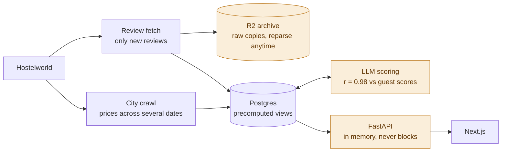

# Hostelview

**[hostelview.com](https://hostelview.com)** is a hostel recommender and price tracker. Pick the
hostels you loved, and it finds the ones most like them in every city, with the optimal time to
book.

https://github.com/user-attachments/assets/7f7e3ef2-c4bc-41ae-996a-473b500f392a

| Path | What | Stack |
| --- | --- | --- |
| [`backend/`](backend) | API, recommender, database schema, LLM rating jobs | Python, FastAPI, Postgres, NumPy, Jev via OpenRouter, Cloudflare R2 |
| [`frontend/`](frontend) | Web app | Next.js, React, TypeScript, Tailwind, d3, Recharts |

## About the data

The live site is built from Hostelworld reviews. **The ingestion jobs that collect them and the
scraped data are not part of this repository.**

## Features

**Explore.** Cities on a d3 world map, rated by their best hostel or the average of their top
five, filtered by rating and price.

**Hostel pages.** Ratings by aspect, from guests or read from the review texts by an LLM (switch
between the two), guest scores over time with reviews per week (drag across the chart to read the
reviews of a period), who stays there (age, travel group, nationality) and "Guests of this hostel
also stayed at".

**For you.** Recommendations from the hostels you loved or disliked and the aspects you care
about. See below.

## Architecture

- **Prices** are sampled over six two-night stays per city, not a single date. Hostels missing
  from three weeks of crawls are marked delisted.
- **Reviews** are fetched only when newer than the last stored one, and all-or-nothing per
  hostel: a fetch that fails halfway stores nothing and is retried on the next run.
- **Raw responses are archived in R2**, gzipped, so the tables can be rebuilt with new parsing
  without fetching again.
- **Materialized views**, refreshed after each load, make most endpoints a single indexed query.
- **LLM scores** for the overall rating correlate with guest scores at r = 0.98 across 99
  hostels, with aspects being rated more independently (see [LLM scoring](#llm-scoring)).
- **The graph and profiles live in memory**, rebuilt hourly in a background thread while the old
  copy keeps serving, so no request waits for a rebuild.

## How For you ranks hostels

> **score = rating + closeness to the hostels you loved**

Code: [`backend/app/recommend.py`](backend/app/recommend.py).

### Rating

**A Bayesian average of the guest score.** Hostels with few reviews are pulled towards the
average of all hostels, so lucky streaks don't count for much. Hostels with fewer than 20 stored
reviews aren't ranked.

| Reviews | Guest average | Rating |
| --- | --- | --- |
| 25 | 10.0 | 9.59 |
| 2,000 | 9.7 | 9.69 |

**Your aspects are averaged in.** An *important* aspect counts as much as the overall score,
and a *top priority* counts twice as much.

| You care about | Rating |
| --- | --- |
| nothing in particular | 9.4 |
| cleanliness (9.8): top priority | (9.4 + 2 × 9.8) / 3 = 9.67 |

### Closeness

How much a hostel resembles the ones you loved, measured by two signals:

- **Loved by the same guests** (co-visitation graph, `graph.py`). Hostels are linked when at
  least two guests rated both 9.4 or higher. Ratings skew high (10 is the most common score), so
  9.4 is the line for a real endorsement. A random walk with restart from your hostels scores every
  hostel by how often it's reached, so hostels a few links away still surface.
- **Same kind of place** (content similarity, `similarity.py`). This covers hostels with no
  shared guests. Each hostel gets a profile of who typically stays there and what kind of place
  it is, and profiles are compared by cosine similarity.

| Group | Source | Weight |
| --- | --- | --- |
| travelling as (solo woman, solo man, couple, group) | guest data | 1 |
| age | guest data | 1 |
| nationality | guest data | ½ |
| comfort (cleanliness, facilities vs. overall) | LLM | 1 |
| social atmosphere | LLM | 1 |
| hosting (hosted meals, organised activities) | LLM | ½ |

Each group's weight is split evenly across its traits. When both signals reach a hostel, the
graph counts for more.

### How they combine

Closeness adds up to **+1.2 rating points**. The best match gets the full bonus, and unrelated
hostels get close to none. Disliked hostels subtract up to 0.6.

The best hostels' ratings are only a few tenths apart (9.5–9.9), so among them closeness decides
the order. A hostel rated more than 1.2 points lower can't win on closeness.

Each recommendation says why it's there: *"Liked by guests from Hostel X"* or *"Similar to Hostel Y"*.

### LLM scoring

An LLM reads ratings from the review texts (`ratings.py`, `hosting.py`). It rates the aspects
guests score, like cleanliness and staff, and traits no guest score covers, such as whether it
hosts shared dinners or organised activities.

- **Model.** Jev (`typesafe/jev-1.13`) is a classification model: it answers typed questions
  about a given text instead of generating free text. Each hostel gets one batched call, with
  one question per trait, over its newest reviews (about 110k characters).
- **Scale.** Each question offers 10 ordered levels spaced evenly from 0 to 1. Each level is
  labelled with its value.
- **Score.** Jev returns a probability for each level. The rating is the probability-weighted
  average. It falls between levels, and lands in the middle when the reviews are mixed.
- **Calibration.** Where guests also give a score (cleanliness, staff, …), a linear fit maps the
  model's ratings onto the guest scale (`rating_calibration.json`, `calibrate_ratings.py`).
